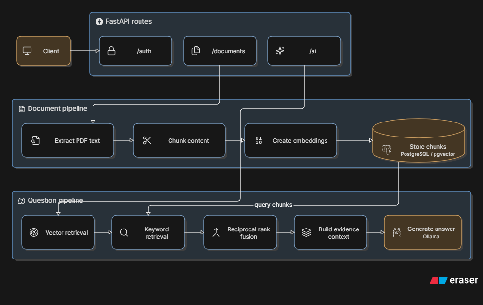

# Document Intelligence API

A self-hosted FastAPI service for ingesting documents, retrieving relevant evidence, and answering questions grounded in uploaded content.

The project began as a legal-document RAG application and is being organized toward a reusable document-intelligence API. The current implementation supports text-based PDF processing. OCR and organization-level knowledge isolation are future capabilities, not current features.

## Current capabilities

- User registration, login, and JWT-protected endpoints
- PDF upload and local file storage
- Page-level text extraction from text-based PDFs
- Chunking with overlap for retrieval
- Embedding generation through a local Ollama instance
- PostgreSQL + pgvector storage
- Hybrid retrieval using vector similarity, PostgreSQL full-text search, and reciprocal rank fusion
- Evidence-grounded answer generation with page-level sources
- Basic request rate limiting and Prometheus metrics exposure

## Architecture



The API has two connected flows:

- **Document pipeline:** uploaded PDFs are extracted, chunked, embedded, and stored in PostgreSQL with pgvector.
- **Question pipeline:** questions trigger vector and keyword retrieval, reciprocal-rank fusion, evidence-context construction, and answer generation through Ollama.

## Project structure

```text
app/
|-- api/
|   |-- ai.py             # Question-answering endpoint
|   |-- auth.py           # Registration, login, current-user endpoint
|   `-- documents.py      # PDF upload and processing endpoint
|-- core/
|   `-- limiter.py        # Rate-limit configuration
|-- database/
|   |-- database.py       # SQLAlchemy engine and sessions
|   `-- models.py         # User, Document, and DocumentChunks models
|-- llm/
|   `-- agent_api.py      # Ollama embedding and generation client
|-- pipeline/
|   |-- context.py        # Grounded prompt construction
|   |-- ingestion.py      # PDF extraction, chunking, indexing
|   `-- retrieval.py      # Vector, keyword, and hybrid retrieval
|-- auth_helpers.py
|-- main.py
|-- schemas.py
`-- settings.py

alembic/                  # Database migrations
docs/images/              # Architecture diagram
uploads/                  # Locally stored uploaded PDFs
metrics/                  # Local timing metrics
```

## Requirements

- Python 3.10+
- PostgreSQL with the `pgvector` extension enabled
- Ollama running locally
- Ollama models:
  - `nomic-embed-text` for embeddings
  - `llama3.2:3b` for answer generation

Install and start the required Ollama models:

```bash
ollama pull nomic-embed-text
ollama pull llama3.2:3b
ollama serve
```

## Configuration

Create a `.env` file in the repository root:

```env
JWT_SECRET=replace-with-a-secure-secret
ENV=development
DB_NAME=document_intelligence
DB_HOST=localhost
DB_PORT=5432
DB_USERNAME=postgres
DB_PASSWORD=replace-with-your-password
ALGORITHM=HS256
ACCESS_TOKEN_EXPIRE_MINUTES=30
```

The variable names must match the settings defined in `app/settings.py`.

## Database setup

Create a PostgreSQL database and enable pgvector:

```sql
CREATE DATABASE document_intelligence;
```

Then, in that database:

```sql
CREATE EXTENSION IF NOT EXISTS vector;
```

Run the migration:

```bash
alembic upgrade head
```

## Run the API

Install the Python dependencies used by the application, then start FastAPI:

```bash
uvicorn app.main:app --reload
```

The API and interactive documentation are available at:

```text
http://127.0.0.1:8000
http://127.0.0.1:8000/docs
```

Prometheus metrics are exposed at:

```text
http://127.0.0.1:8000/metrics
```

## API overview

### Register a user

```http
POST /auth/register
Content-Type: application/json
```

```json
{
  "first_name": "Jane",
  "second_name": "Doe",
  "username": "janedoe",
  "email": "jane@example.com",
  "password": "SecurePass1!",
  "confirm_password": "SecurePass1!"
}
```

### Log in

```http
POST /auth/login
Content-Type: application/x-www-form-urlencoded
```

```text
username=janedoe&password=SecurePass1!
```

The response includes a Bearer access token.

### Upload a PDF

```http
POST /documents/upload
Authorization: Bearer <access-token>
Content-Type: multipart/form-data
```

Form field:

```text
file=<your-document.pdf>
```

A successful response includes a `document_id`.

### Ask a question about a document

```http
POST /ai/ask/{document_id}
Authorization: Bearer <access-token>
Content-Type: application/json
```

```json
{
  "question": "What is the deadline stated in this document?"
}
```

Example response shape:

```json
{
  "success": true,
  "message": "Document uploaded and processed successfully",
  "data": {
    "response": "The deadline is ...",
    "sources": ["contract.pdf, Page: 3"]
  }
}
```

## Processing model

The current pipeline uses normal text extraction:

```text
PDF
  -> pypdf text extraction
  -> page-aware chunks
  -> embeddings
  -> PostgreSQL / pgvector index
  -> hybrid retrieval
  -> grounded LLM response
```

This is appropriate for digitally generated PDFs with selectable text. Image-only PDFs and poor scans may produce little or no usable text.

## Future features and optimizations

### Upcoming work

- [ ] **Background workers and Redis queues:** move extraction, chunking, and embedding work from the request lifecycle into Celery workers with Redis as the broker and task-result backend.
- [ ] **Asynchronous job management:** return a processing job identifier, then expose status, progress, retries, failures, and processing history.
- [ ] **Bulk document ingestion:** ingest document collections rather than requiring one-file-at-a-time uploads.
- [ ] **Google Drive ingestion:** import approved Google Drive folders or files while preserving source identifiers and metadata.
- [ ] **Amazon S3 ingestion:** import files from configured buckets or prefixes, retaining their source references and synchronization state.
- [ ] **Source synchronization:** schedule or trigger re-indexing when a connected source adds, changes, or removes documents.
- [ ] **Processing scalability:** tune worker concurrency, queue routing, embedding batch sizes, and retry policies for large collections.
- [ ] **Dockerized deployment:** provide Docker images and Docker Compose services for the API, Celery worker, Redis, PostgreSQL with pgvector, Prometheus, and Grafana.
- [ ] **Grafana observability:** have Prometheus scrape API and worker metrics, then build Grafana dashboards for request latency, queue depth, task success/failure rates, processing duration, retry counts, and resource use.

### Later capabilities

- [ ] **User-selected processing modes:** let the caller explicitly choose normal text extraction or OCR for each upload.
- [ ] **OCR extraction:** support scanned PDFs and image-based documents through an interchangeable OCR module.
- [ ] **Additional file types:** extend ingestion beyond PDFs to supported images and office documents.
- [ ] **Document management:** list, inspect, retry, and delete uploaded documents, including their stored chunks.
- [ ] **Organization workspaces:** separate knowledge bases, document collections, access rules, and terminology by organization.
- [ ] **Richer source evidence:** return extraction warnings, page-level confidence, and more structured citations where available.
- [ ] **Evaluation tooling:** track retrieval quality, groundedness, latency, and regressions across representative document sets.
- [ ] **Controlled action integrations:** after authorization and audit controls are mature, use retrieved knowledge to draft emails, create tickets, or call approved external systems.

## Roadmap

1. **Complete and validate the current structural refactor.** Preserve endpoint behavior while verifying upload, extraction, chunking, embedding, retrieval, source attribution, and failure states.
2. **Introduce Celery workers and Redis queues.** Move document extraction, chunking, and embedding work out of the upload request lifecycle.
3. **Add asynchronous job management.** Return job identifiers and provide status, progress, retries, failures, and processing history.
4. **Support bulk ingestion.** Design a common ingestion interface for collections of documents rather than one-file-at-a-time uploads.
5. **Connect Google Drive and Amazon S3.** Start with controlled imports from approved folders, buckets, or prefixes while retaining source metadata.
6. **Add source synchronization.** Detect or schedule updates, additions, and removals in connected sources, then re-index affected documents safely.
7. **Optimize processing at scale.** Configure queue routing, worker concurrency, embedding batches, retry policies, and backpressure for large collections.
8. **Dockerize the platform.** Provide Docker images and a Compose environment for the API, worker, Redis, PostgreSQL with pgvector, Prometheus, and Grafana.
9. **Implement monitoring and dashboards.** Extend metrics to background processing, scrape them with Prometheus, and create Grafana dashboards and alerts for API, queue, worker, database, and ingestion health.
10. **Add selectable extraction modes and OCR.** Keep normal text extraction and OCR as interchangeable ingestion components, with the user retaining the final mode choice.
11. **Expand document intelligence capabilities.** Add more supported file types, document-management operations, richer source evidence, evaluations, and organization-level isolation.
12. **Add controlled action integrations.** Only after retrieval quality, authorization, audit logs, and duplicate protection are mature, support scoped email, ticket, or external-system actions.
